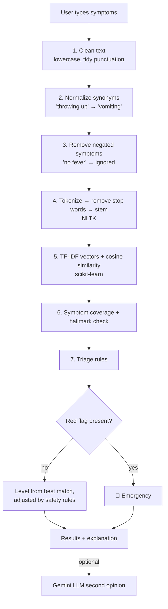

# 🩺 AI Symptom Checker & Triage Tool

An AI-driven web application that reads a person's symptoms written in plain English, suggests the most likely conditions, and recommends a **triage level**: how urgently they should seek care.

The core uses **Natural Language Processing (NLP)** with NLTK and scikit-learn. A rule-based safety layer means warning signs such as chest pain or stroke symptoms always lead to an emergency recommendation. An optional **Large Language Model (Google Gemini)** can add a written second opinion.

> ⚠️ **Disclaimer:** This is a student project for educational purposes only. It is **not** a medical device and is **not** a substitute for professional medical advice, diagnosis, or treatment. In an emergency, call 911 (US) or your local emergency number.

*Course: Module 03, AI in Healthcare (peer-reviewed assignment)*

---

## Table of contents
1. [The healthcare innovation](#1-the-healthcare-innovation-ai-symptom-checkers)
2. [What the app does](#2-what-the-app-does)
3. [How it works](#3-how-it-works)
4. [Project structure](#4-project-structure)
5. [Installation & running](#5-installation--running)
6. [Example results](#6-example-results)
7. [Testing](#7-testing)
8. [Ethical considerations](#8-ethical-considerations)
9. [Limitations & future work](#9-limitations--future-work)
10. [How this project was built](#10-how-this-project-was-built)
11. [References](#11-references)

---

## 1. The healthcare innovation: AI symptom checkers

**Symptom checkers** are digital tools in which a patient enters their symptoms and receives a list of possible diagnoses plus triage advice. Examples include Ada Health, the Babylon chatbot once used within the UK's NHS, and Ubie. They have also been used to direct patients to the right level of care. Recently, general-purpose large language models such as GPT-4, Claude and Gemini have been tested on the same task.

**What the research says:**

- **Accuracy has been modest.** A 2015 *BMJ* audit tested 23 online symptom checkers on 45 standardized patient cases. They listed the correct diagnosis first in about a third of cases and gave appropriate triage advice in just over half. The tools also tended to be risk-averse, often sending people to care when self-care would have been reasonable (Semigran et al., 2015).
- **The problem has persisted.** A 2022 systematic review in *npj Digital Medicine* looked at ten studies covering 48 symptom checkers. It found primary-diagnosis accuracy of roughly 19-38%. Triage accuracy was better, at about 49-90%. Both varied widely between tools, and the authors warned that relying on them could pose patient-safety risks (Wallace et al., 2022).
- **LLMs are a new chapter.** A study in *The Lancet Digital Health* compared GPT-3 with lay people and primary care physicians on 48 validated case vignettes. GPT-3's diagnosis was close to, but below, physician level. Its triage was weaker, closer to that of lay people (Levine et al., 2024). A 2024 follow-up in *JMIR* tested newer frontier models (GPT-4o, Claude 3.5 Sonnet, Gemini 1.5 Pro) on the same vignettes to track how fast these capabilities are improving.

**Design lessons taken from this research:**

1. **Triage matters more than diagnosis.** Telling someone *where* to go is safer and more achievable than naming a disease, so triage is the app's headline output.
2. **Never miss an emergency.** Explicit red-flag rules override everything else.
3. **Avoid needless alarm.** The engine requires hallmark signs before suggesting an emergency-level condition. This addresses the over-triage problem the BMJ audit found.
4. **Be transparent.** The app shows *why* it chose a level and exactly what its NLP pipeline did, instead of acting as a black box.

---

## 2. What the app does

- Accepts free-text symptoms ("it burns when I pee and I'm peeing a lot").
- Understands everyday language through about 90 synonym mappings ("throwing up" → vomiting).
- Handles **negation**: in "cough but no fever", the fever is ignored.
- Ranks **24 common conditions** and shows the top three, each with:
  - a confidence label
  - the symptoms that matched
  - general advice
- Recommends one of four triage levels:

| Level | Meaning |
|---|---|
| 🔴 **Emergency** | Call 911 / go to the emergency department now |
| 🟠 **Urgent Care** | Be seen today |
| 🔵 **Primary Care** | See your doctor within a few days |
| 🟢 **Self-Care** | Likely manageable at home; monitor symptoms |

- Explains the reasoning behind every triage decision.
- Shows red-flag warnings, including a crisis-line message (988 in the US) for self-harm language.
- Has an optional **Gemini LLM second opinion**, clearly labelled and never allowed to override the safety rules.
- Stores no data and logs nothing.

> 📸 *Add a screenshot here after running the app:* ``

---

## 3. How it works



### The NLP pipeline (`symptom_engine.py`)

| Step | Technique | Why |
|---|---|---|
| Synonym normalization | Single-pass regex, longest phrase first | People say "can't breathe", not "dyspnea" |
| Negation handling | Split into clauses; drop text after *no / not / without / denies* | "No chest pain" must **not** trigger an emergency |
| Tokenization | NLTK `RegexpTokenizer` | Split text into words |
| Stop-word removal | Custom medical-aware list | Generic lists delete words like "side" and "back", which matter medically |
| Stemming | NLTK `PorterStemmer` | "aches", "aching" and "ache" all match |
| Vectorization | scikit-learn `TfidfVectorizer` (unigrams + within-phrase bigrams) | Rare, distinctive symptoms (e.g. "stiff neck") weigh more than common ones (e.g. "fever") |
| Similarity | Cosine similarity | Compares the user's description to each condition profile |

**Score** = 0.7 × cosine similarity + 0.3 × fraction of the condition's symptoms that were matched.

### Triage safety rules
1. **Base level:** the default triage of the best-matching condition.
2. **Thin evidence:** if only one symptom matched, the level is capped at Primary Care.
3. **Hallmark check:** an emergency-level condition (e.g. meningitis) only produces "Emergency" if a hallmark sign (e.g. stiff neck) is present. Without one, its score is halved.
4. **Caution:** if a serious condition with 3+ matching symptoms is in the shortlist, the level is at least Urgent Care.
5. **Severity words** such as "severe" or "unbearable" raise the level one step, but no higher than Urgent Care on their own.
6. **Red flags always win.** Warning signs force "Emergency". They are checked last so nothing can downgrade them. Examples: chest pain, difficulty breathing, stroke signs, fever with stiff neck, throat swelling, heavy bleeding, fainting or seizure, suicidal thoughts.

### Optional LLM layer (`llm_assistant.py`)
When an API key is set, the app sends the symptoms to Google Gemini with an engineered prompt. The prompt asks for:
- a cautious, structured answer
- possible conditions, a triage level with a reason
- questions a clinician might ask
- self-care tips

The LLM's text is shown separately, and the rule-based triage stays in charge. This hybrid design combines the LLM's language understanding with the predictability of rules.

---

## 4. Project structure

```
ai-symptom-checker/
├── app.py              # Streamlit web interface
├── symptom_engine.py   # NLP pipeline, matching and triage logic (the "AI")
├── knowledge_base.py   # Conditions, synonyms, red flags, triage levels
├── llm_assistant.py    # Optional Gemini LLM second opinion
├── tests/
│   └── test_engine.py  # 22 automated tests (pytest)
├── requirements.txt
└── README.md
```

---

## 5. Installation & running

**Requirements:** Python 3.9 or newer.

```bash
# 1. Clone the repository
git clone https://github.com/<your-username>/ai-symptom-checker.git
cd ai-symptom-checker

# 2. (Recommended) create a virtual environment
python -m venv venv
source venv/bin/activate        # Windows: venv\Scripts\activate

# 3. Install dependencies
pip install -r requirements.txt

# 4. Run the app
streamlit run app.py
```

The app opens in your browser at `http://localhost:8501`. No NLTK data downloads are needed.

You can also try the engine from the terminal without the web interface:

```bash
python symptom_engine.py
```

### Enabling the optional Gemini LLM mode
1. Create a free API key at [Google AI Studio](https://aistudio.google.com).
2. Set it as an environment variable **(never paste it into the code)**:
   ```bash
   export GEMINI_API_KEY="your-key"        # Windows: set GEMINI_API_KEY=your-key
   ```
3. Optionally choose a model:
   ```bash
   export GEMINI_MODEL="gemini-2.5-flash"
   ```
   Google retires model names over time. If you see an error, set this to a current model from the Gemini docs.
4. Restart the app and switch on **"LLM second opinion"** in the sidebar.

---

## 6. Example results

These are actual outputs from the app:

| Input | Top condition (confidence) | Triage |
|---|---|---|
| Runny nose, sneezing and a scratchy throat, no fever | Common Cold (High) | 🟢 Self-Care |
| Fever, chills, body aches and I'm exhausted | Influenza (High) | 🔵 Primary Care |
| It burns when I pee and I need to pee a lot | Urinary Tract Infection (High) | 🔵 Primary Care |
| I have a severe headache and a high fever. | Influenza (Moderate) | 🟠 Urgent Care |
| Wheezing and tight chest, short of breath | Asthma Flare-up (High) | 🟠 Urgent Care |
| Crushing chest pain going down my left arm and I'm sweaty | Heart Attack, possible (High) | 🔴 Emergency |
| Cough and runny nose, no chest pain | Common Cold (Moderate) | 🟢 Self-Care |

The last row shows negation handling: "no chest pain" does **not** trigger the chest-pain red flag. The fourth row shows the hallmark rule: headache + fever is escalated because of the word "severe", but it is not labelled meningitis without a stiff neck or confusion.

---

## 7. Testing

```bash
pytest -q
```

The suite has 22 tests. They cover 13 realistic patient descriptions with expected condition and triage, plus the main behaviours:
- negation
- synonyms
- red-flag override
- negated red flags
- crisis language
- severity escalation
- unknown input
- empty input

All tests pass.

> These test cases are a small sanity-check set written by the author. They are not a clinical validation. A real evaluation would measure accuracy, sensitivity for emergencies, and over-triage rates on hundreds of clinician-labelled vignettes, as in the studies above.

---

## 8. Ethical considerations

**Patient safety**
- Red-flag rules guarantee emergency advice for life-threatening warning signs. The design deliberately accepts some over-triage in exchange for not missing emergencies.
- The disclaimer is shown at the top of the page, not hidden in a footer.
- The app suggests *possible* conditions with confidence labels and never claims a diagnosis.

**Privacy**
- No symptom text is stored, logged, or sent anywhere by default.
- The LLM mode is opt-in and the sidebar warns that text will be sent to Google. A real product handling health data would need, at minimum:
  - HIPAA/GDPR compliance
  - encryption
  - data minimisation
  - informed consent

**Bias and fairness**
- The knowledge base was written by hand and reflects *typical adult* presentations, often as described in Western medical sources.
- Symptoms can present differently in women (e.g. heart attacks), children, older adults, pregnant people, and different ethnic groups.
- The app only understands English and may miss dialects, slang, or non-native phrasing.
- LLMs inherit biases from their training data.

**Transparency and accountability**
- Every decision is explained ("Why this triage level?"), and the NLP pipeline is visible.
- Rules are easy to audit because they live in one readable file (`knowledge_base.py`).

**Regulation**
- In the US, software that diagnoses or triages patients can be regulated by the FDA as *Software as a Medical Device*. A real deployment would need clinical validation and regulatory review.

**Over-reliance**
- Users may trust an app too much. The app repeatedly encourages professional care whenever there is uncertainty.

---

## 9. Limitations & future work

**Limitations**
- The knowledge base covers 24 conditions and is not clinically validated.
- The app does not consider age, sex, medical history, medications, or symptom duration.
- Keyword and TF-IDF matching can miss unusual phrasing. Negation handling is simple (e.g. "not sure if I have a fever" ignores the fever).
- Confidence labels are heuristic, not calibrated probabilities.

**Future work**
- Ask follow-up questions (age, duration, severity scale) like a real triage nurse.
- Train a supervised model (e.g. Naive Bayes or logistic regression) on a licensed, labelled symptom dataset.
- Use a clinical NLP library or medical embeddings (e.g. scispaCy, BioBERT) for better understanding.
- Evaluate on published clinical vignettes and report sensitivity and specificity for emergencies.
- Add multilingual support and accessibility features.

---

## 10. How this project was built

This project follows **Option 1** of the assignment: it was generated end-to-end with an AI assistant (**Claude by Anthropic**). That covered design, knowledge base, code, comments, tests and documentation. The author then reviewed, ran and tested the application. All code is commented to explain how each part works.

---

## 11. References

1. Semigran HL, Linder JA, Gidengil C, Mehrotra A. *Evaluation of symptom checkers for self diagnosis and triage: audit study.* BMJ. 2015;351:h3480. https://doi.org/10.1136/bmj.h3480
2. Wallace W, Chan C, Chidambaram S, et al. *The diagnostic and triage accuracy of digital and online symptom checker tools: a systematic review.* npj Digital Medicine. 2022;5(1). https://doi.org/10.1038/s41746-022-00667-w
3. Levine DM, Tuwani R, Kompa B, et al. *The diagnostic and triage accuracy of the GPT-3 artificial intelligence model: an observational study.* The Lancet Digital Health. 2024. Preprint: https://pmc.ncbi.nlm.nih.gov/articles/PMC9915829
4. *The Triage and Diagnostic Accuracy of Frontier Large Language Models: Updated Comparison to Physician Performance.* Journal of Medical Internet Research. 2024. https://www.jmir.org/2024/1/e67409
5. Olsen E. *Study: Symptom checkers' diagnostic, triage accuracy is low.* MobiHealthNews. https://www.mobihealthnews.com/news/study-symptom-checkers-diagnostic-triage-accuracy-low
